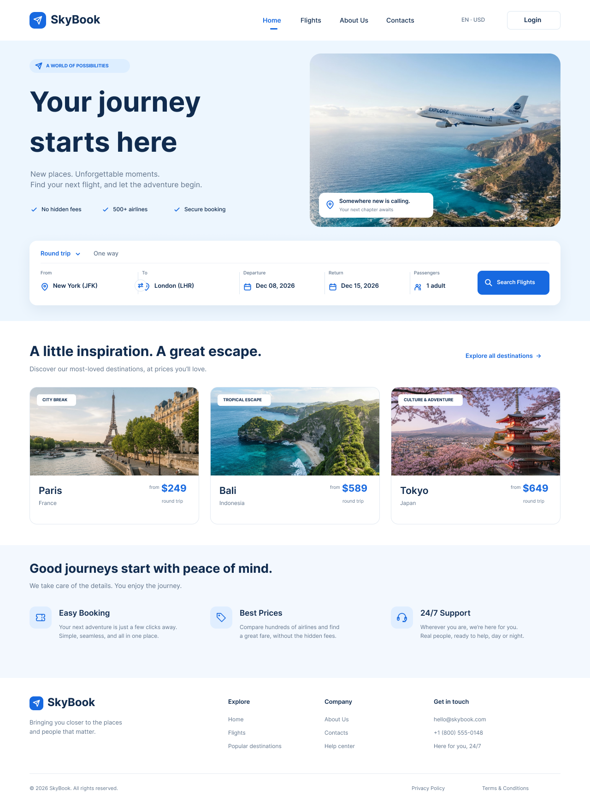
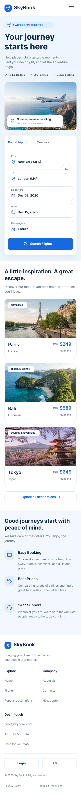

# Лабораторна робота № 1

## Визначення власного об’єкта дослідження (наскрізна задача). Структура веб-проєкту та організація репозиторію GitHub

**Дисципліна:** WEB-програмування  
**Виконав:** Касаткін Микита Валентинович  
**Група:** [КІ-24]  
**Варіант:** 7  
**Тема проєкту:** Каталог і бронювання авіаквитків  
**Назва проєкту:** SkyBook

---

## 1. Мета роботи

Обрати предметну область наскрізного проєкту, сформулювати вимоги до нього, спроєктувати структуру веб-застосунку, створити макети сторінок та організувати репозиторій GitHub для поетапної розробки проєкту протягом семестру.

## 2. Індивідуальне завдання

Згідно з варіантом № 7 обрано тему «Каталог і бронювання авіаквитків».

Метою проєкту SkyBook є створення веб-застосунку для пошуку авіарейсів, перегляду інформації про перельоти та бронювання авіаквитків.

Основні можливості майбутнього застосунку:
- пошук авіарейсів за містом відправлення та призначення;
- перегляд доступних рейсів;
- перегляд детальної інформації про рейс;
- заповнення форми бронювання;
- збереження інформації про пасажирів та квитки.

### 2.1. Основні сутності предметної області

**Airport (Аеропорт)**

- `id` — унікальний ідентифікатор;
- `name` — назва аеропорту;
- `city` — місто;
- `country` — країна;
- `code` — код аеропорту.

**Flight (Рейс)**

- `id` — унікальний ідентифікатор;
- `departure_airport_id` — аеропорт відправлення;
- `arrival_airport_id` — аеропорт прибуття;
- `departure_time` — час відправлення;
- `arrival_time` — час прибуття;
- `price` — вартість квитка;
- `status` — статус рейсу.

**Passenger (Пасажир)**

- `id` — унікальний ідентифікатор;
- `first_name` — ім’я;
- `last_name` — прізвище;
- `email` — електронна пошта;
- `phone` — номер телефону.

**Ticket (Квиток)**

- `id` — унікальний ідентифікатор;
- `flight_id` — ідентифікатор рейсу;
- `passenger_id` — ідентифікатор пасажира;
- `seat` — місце;
- `price` — ціна;
- `status` — статус квитка;
- `booking_date` — дата бронювання.

### 2.2. Зв’язки між сутностями

- Airport 1 — ∞ Flight: один аеропорт може бути аеропортом відправлення або прибуття для багатьох рейсів.
- Flight 1 — ∞ Ticket: один рейс може мати багато квитків.
- Passenger 1 — ∞ Ticket: один пасажир може мати декілька квитків.

### 2.3. Основні сторінки застосунку

1. `/` — головна сторінка з формою пошуку авіаквитків.
2. `/flights` — перелік доступних рейсів із можливістю фільтрації.
3. `/flight/:id` — детальна картка вибраного рейсу.
4. `/booking` — форма бронювання квитка.
5. `/contacts` — контактна інформація.

## 3. Хід роботи

### 3.1. Створення репозиторію GitHub

Було створено публічний репозиторій GitHub із назвою `SkyBook`.

Посилання на репозиторій:  
https://github.com/newt1sh/SkyBook

Під час створення репозиторію було додано файли `README.md` та `.gitignore`.

### 3.2. Створення структури проєкту

Для організації файлів було створено таку структуру каталогів:

```text
SkyBook/
├── docs/
│   ├── mockups/
│   │   ├── home-desktop.png
│   │   └── home-mobile.png
│   └── requirements.md
├── src/
│   ├── pages/
│   │   └── index.html
│   ├── css/
│   │   └── style.css
│   ├── js/
│   └── assets/
│       └── img/
├── labs/
│   └── lab01/
│       └── report.md
├── README.md
└── .gitignore
```

Каталог `docs` містить документацію та макети, `src` — файли веб-застосунку, а `labs` — звіти з лабораторних робіт.

### 3.3. Створення документа вимог

Було створено файл `docs/requirements.md`, у якому описано призначення застосунку, сутності предметної області, їхні атрибути та зв’язки, перелік сторінок, функціональні й нефункціональні вимоги.

### 3.4. Створення макетів інтерфейсу

За допомогою Figma було створено два макети головної сторінки SkyBook:

- Desktop — версія для екрана шириною 1280 px;
- Mobile — адаптивна версія для екрана шириною 360 px.

На макетах передбачено навігацію, форму пошуку авіаквитків, популярні напрямки, переваги сервісу та контактну інформацію.

**Рисунок 1 — Макет головної сторінки Desktop**



**Рисунок 2 — Макет головної сторінки Mobile**



### 3.5. Створення початкової HTML-сторінки

Було створено файл `src/pages/index.html`, який містить базову HTML-структуру головної сторінки: шапку сайту, навігацію, блок пошуку авіаквитків та підвал.

Для створення форми пошуку використано HTML-елементи `form`, `label`, `input` і `button`.

### 3.6. Створення CSS-оформлення

Було створено файл `src/css/style.css` для базового оформлення сторінки. У ньому визначено кольори, відступи, розташування елементів, оформлення форми та адаптивні правила для вузьких екранів за допомогою `@media`.

### 3.7. Робота з Git

Для виконання лабораторної роботи було створено окрему гілку `lab01`.

У процесі роботи створено три змістовні коміти:

| Коміт | Повідомлення |
|---|---|
| `6a3b462` | Add project structure and UI mockups |
| `a6f8bf9` | Add initial SkyBook homepage |
| `87c9bdf` | Add responsive homepage styling |

Після цього гілку `lab01` було відправлено на GitHub командою:

```bash
git push -u origin lab01
```

Для об’єднання змін з основною гілкою було створено Pull Request № 1. Його успішно об’єднано з гілкою `main`.

Посилання на Pull Request:  
https://github.com/newt1sh/SkyBook/pull/1

## 4. Результати роботи

У результаті виконання лабораторної роботи:
- обрано предметну область та визначено призначення проєкту SkyBook;
- описано чотири основні сутності та їхні зв’язки;
- створено документ вимог;
- підготовлено Desktop і Mobile макети головної сторінки;
- створено початкову HTML-сторінку та CSS-файл;
- організовано структуру каталогів;
- створено публічний репозиторій GitHub;
- виконано три коміти в окремій гілці;
- успішно об’єднано гілку `lab01` з `main` через Pull Request.

## 5. Висновки

Під час виконання лабораторної роботи було обрано тему наскрізного проєкту SkyBook — каталогу та сервісу бронювання авіаквитків. Визначено основні сутності предметної області, їхні атрибути та зв’язки, сформульовано вимоги до майбутнього веб-застосунку.

Було створено макети головної сторінки для комп’ютерних і мобільних пристроїв, підготовлено початкову HTML-структуру та CSS-оформлення. Також було освоєно основні операції Git і GitHub: створення гілки, фіксацію змін комітами, відправлення гілки на віддалений репозиторій та об’єднання змін через Pull Request.

У результаті сформовано початкову основу веб-проєкту, яку можна використовувати для подальшої розробки протягом семестру.

## 6. Контрольні запитання

**1. Що таке наскрізна задача та які переваги дає такий спосіб організації практикуму?**

Наскрізна задача — це єдиний проєкт, який розробляється протягом семестру в межах кількох лабораторних робіт. Кожна наступна робота доповнює попередню новими можливостями. Це дозволяє поступово створити повноцінний веб-застосунок і закріпити практичні навички.

**2. Які вимоги висуваються до предметної області проєкту?**

Предметна область повинна містити щонайменше три сутності, між якими є зв’язок «один до багатьох». Застосунок повинен мати щонайменше чотири розділи: головну сторінку, перелік, картку запису та форму. Також необхідні користувацьке введення з валідацією, можливість зберігання даних у реляційній базі даних та адаптивність від 360 px.

**3. Назвіть три області Git та поясніть призначення кожної.**

- Робочий каталог (Working Directory) — місце, де розробник створює та змінює файли.
- Область індексу (Staging Area) — місце, куди додаються зміни для наступного коміту за допомогою `git add`.
- Локальний репозиторій (Local Repository) — місце збереження історії комітів проєкту.

**4. Чим відрізняються команди git add, git commit, git push і git pull?**

- `git add` — додає зміни до області індексу.
- `git commit` — зберігає підготовлені зміни в локальній історії.
- `git push` — відправляє локальні коміти до віддаленого репозиторію.
- `git pull` — отримує зміни з віддаленого репозиторію та інтегрує їх у поточну гілку.

**5. Що таке гілка та для чого створюється окрема гілка на кожну лабораторну роботу?**

Гілка — це окремий напрямок розробки, який дозволяє працювати над змінами незалежно від основної версії проєкту. Окрема гілка для лабораторної роботи допомагає відокремити її зміни, перевірити результат і лише після цього об’єднати його з основною гілкою.

**6. Що таке Pull Request і які можливості він надає під час перевірки коду?**

Pull Request — це запит на об’єднання змін з однієї гілки в іншу. Він дозволяє переглянути додані зміни, порівняти код, залишити коментарі, обговорити помилки та підтвердити об’єднання.

**7. Для чого призначений файл .gitignore і які шляхи до нього включають?**

Файл `.gitignore` визначає файли та каталоги, які Git не повинен відстежувати. До нього зазвичай додають каталоги залежностей, тимчасові файли, результати збірки, журнали та файли з конфіденційними налаштуваннями, наприклад `node_modules/`, `dist/`, `.env` і `*.log`.

**8. Які розділи має містити файл README.md навчального проєкту?**

README.md повинен містити назву та опис проєкту, інформацію про автора, використані технології, структуру каталогів, інструкції із запуску та таблицю з інформацією про виконання лабораторних робіт.

**9. Чому Git не відстежує порожні каталоги та як це обійти?**

Git відстежує файли, а не порожні каталоги. Щоб зберегти порожню папку в репозиторії, до неї додають спеціальний порожній файл, наприклад `.gitkeep`.

**10. Опишіть типову структуру каталогів клієнтської частини веб-проєкту.**

Типова структура містить:
- `src/pages/` — HTML-сторінки;
- `src/css/` — таблиці стилів;
- `src/js/` — JavaScript-файли;
- `src/assets/img/` — зображення та інші графічні ресурси.

Така структура дозволяє розділити файли за призначенням і спрощує подальшу розробку та супровід проєкту.